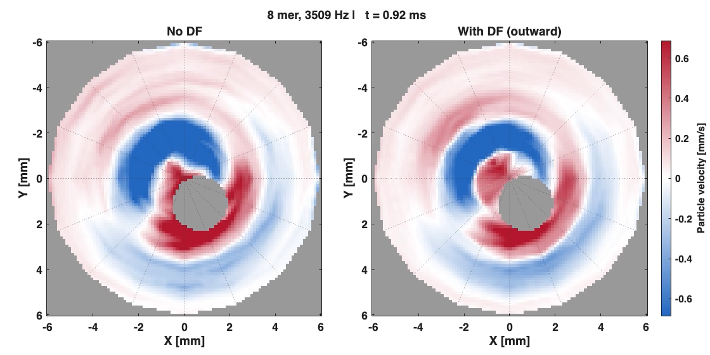
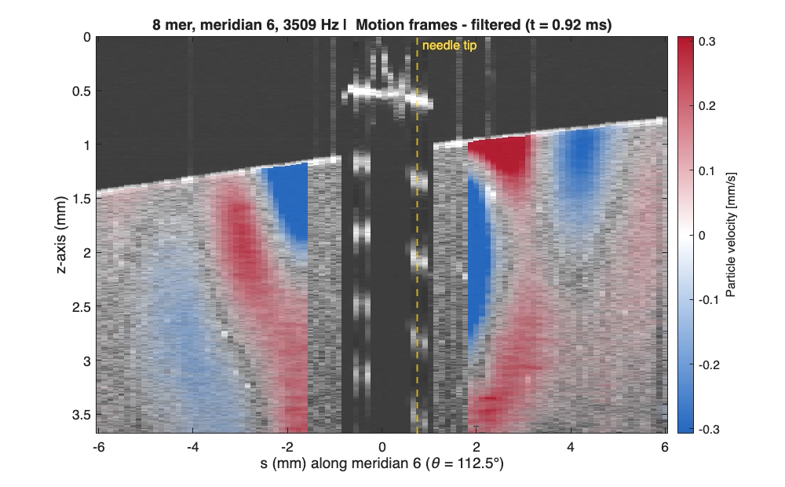
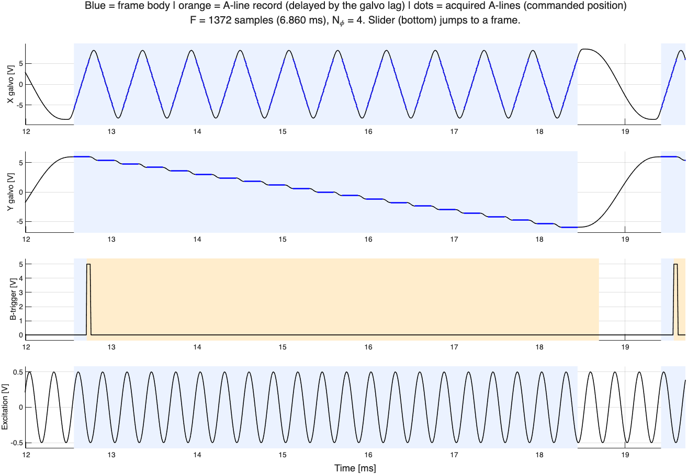
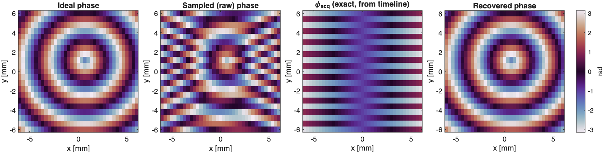

# OCE_Experimental_Protocols

Experimental implementation of the Multimeridian MB and Synchronized BM-mode (SBM) acquisition protocols for wave-based OCE.

Acquisition and processing code used to implement and validate, on a real OCT system, the wave-based Optical Coherence Elastography (OCE) acquisition protocols developed in the undergraduate thesis of **Estéfano Machado Ferrer** (supervisor: Prof. Fernando Zvietcovich, PhD; Biophotonics and Biomedical Optics Research Group, GIBIO, Pontificia Universidad Católica del Perú):

- **Synchronized BM-mode (SBM)**, a novel protocol introduced in the thesis and not yet published in a peer-reviewed journal: raster BM scan locked to a harmonic excitation, repeated over frames so that each pixel is sampled in equivalent time; per-pixel acquisition-phase compensation and 2D phase-gradient speed estimation.
- **Multimeridian MB mode**: M-B scans along several meridians around the excitation source.

The experiments were run on GIBIO's 1300 nm swept-source **Twin OCT** (200 kHz A-line rate, AlazarTech ATS9360 digitizer, NI-DAQ analog outputs, LabVIEW) on tissue-mimicking phantoms. The simulation framework is in the companion repository **[OCE_AcquisitionProtocols_Simulator](https://github.com/emftech/OCE_AcquisitionProtocols_Simulator)**, which also has the thesis manuscript.

## Repository layout

```
OCE_Experimental_Protocols/
├── SBM_Protocol/                      SBM acquisition: hardware-pattern generator and LabVIEW integration
│   ├── SBM_TwinOCT_Config.m           every protocol parameter (edit this)
│   ├── SBM_TwinOCT_Waveform.m         galvo X/Y, B-trigger and excitation AO rows + exact timeline
│   ├── SBM_TwinOCT_LabVIEWNode.m      called from the LabVIEW script node; saves the sidecar
│   ├── Variant_A_ExternalGenerator/   excitation by an external function generator
│   ├── Variant_B_DAQ_Sine/            excitation synthesized by the NI DAQ
│   ├── Tools/                         validation, null checks, smoke tests, quick processing
│   └── Validation/                    figures from the validation tools
├── Codes_SBM_Processing/              SBM processing: raw .bin → recovered wavefield → 2D PG / PG-TV elastograms
│   ├── Main_Processing_SingleExp_SBM_EMF.m, Main_Processing_Batch_SBM_EMF.m
│   ├── SBM_Pipeline/                  SBM functions
│   └── Tests/                         synthetic dataset + end-to-end test
├── Main_Processing_SingleExp_MultimerMB_EMF.m (+ _Live.mlx)   Multimeridian MB processing, one acquisition
├── Main_Processing_Batch_MultimerMB_EMF.m                     all MB acquisitions + summary
├── Make_*_MMB.m                       MB figures and depth videos
├── Check_ExperimentalChain_On_Simulations_MB.m   runs the experimental MB chain on simulated data
├── Codes/                             shared processing functions
│   ├── MultimerMB_Pipeline/           MB functions (MMB_*)
│   ├── PhaseGradient_Framework/       1D/2D phase-gradient and TV-regularized estimators (OCE_*)
│   └── *.m                            GIBIO lab OCE helpers (surface detection, Loupas estimator, ...)
├── Experiment_Log_06_10_2026.xlsx     MB run list
├── Experiment_Log_SBM_19_10_2026.xlsx SBM run list
├── Experimental_Setup_Images/
├── figures/                           representative results (see below)
├── Data/, Results/                    MB raw data / outputs (not tracked)
└── SBM_Experiments/{Data,Sidecars,Results}   SBM raw data, sidecars, outputs (not tracked)
```

Detailed documentation: [`SBM_Protocol/README.md`](SBM_Protocol/README.md) and [`Codes_SBM_Processing/README.md`](Codes_SBM_Processing/README.md).

## Requirements

- MATLAB R2026a (developed and tested).
- Signal Processing, Image Processing, Statistics and Machine Learning, and Curve Fitting toolboxes.
- For running the acquisition: LabVIEW with the Twin OCT acquisition software (not included; it belongs to GIBIO) and the MATLAB script node.
- `Check_ExperimentalChain_On_Simulations_MB.m` and the MB batch's comparison with simulations expect the simulator repository cloned **next to** this one (`../OCE_AcquisitionProtocols_Simulator`).

All paths are relative to the repository root, so nothing has to be edited to run the scripts. The `.m` scripts find the root by themselves. For the live script `Main_Processing_SingleExp_MultimerMB_EMF_Live.mlx`, set MATLAB's current folder to the repository root first.

## Quick start

1. **Check the SBM protocol without hardware:** run `SBM_Protocol/Tools/SBM_TwinOCT_PlotVectors.m` and `SBM_Protocol/Tools/SBM_TwinOCT_Validate.m` (waveform → sampling → phase recovery).
2. **Test the SBM processing end to end:** run `Codes_SBM_Processing/Tests/SBM_Test_Pipeline.m`. It builds synthetic `.bin` files with a known speed (10.54 m/s) and processes them.
3. **Process real data:** put the `.bin` files in `Data/` (MB) or `SBM_Experiments/Data/` (SBM), with names as in the experiment logs, and run the single-experiment or batch scripts.

Raw data are not included because of their size (hundreds of GB); they are available from the author on reasonable request.

## Representative results

The MB experiments below were run on a tissue-mimicking phantom (reference Rayleigh speed c_R = 10.54 m/s from quasi-static compression) with needle excitation on the Twin OCT.

### Multimeridian MB mode: experimental

| | |
|---|---|
|  |  |
| En-face particle-velocity wavefield (8 meridians, 3509 Hz), without and with the outward directional filter | Depth-resolved wavefield along one meridian, overlaid on the B-mode |
|  |  |
| Accuracy error vs. number of meridians for the four estimators (mean ± SD over repetitions) | Phase-speed dispersion over 9 excitation frequencies |


Phase-speed maps for 4, 8, 16 and 32 meridians (rows) with 1D PG, 1D PG-TV, 2D PG and 2D PG-TV (columns), 3509 Hz, directional filter on.

### SBM: protocol validation and end-to-end test on synthetic data

| | |
|---|---|
|  |  |
| One SBM frame as sent to the hardware: galvo X/Y, B-trigger and excitation, all on the A-line clock | Ideal phase, raw sampled phase, exact acquisition phase from the timeline, and recovered phase after compensation |


Full SBM processing chain on synthetic `.bin` files (37 x 21 raster, 57 frames, 3509 Hz, true c = 10.54 m/s): 2D PG and 2D PG-TV, without and with the directional filter.

## Credits

- Protocols, acquisition generator, SBM and MB pipelines and phase-gradient framework: Estéfano Machado Ferrer (parts written with Claude Code).
- The helper functions directly in `Codes/` (e.g. `FindSurface`, `Loupas2D_Fast`, `Elastogram`, `MotionAnalysisBorder`, `PhaseDerivativeSpeed`) come from the GIBIO OCE processing codes developed in Prof. Fernando Zvietcovich's group; `nanmedfilt2` is adapted from a MATLAB Central thread.

## Citation

Please cite the thesis (and the corresponding journal articles once published):

```bibtex
@thesis{MachadoFerrer2026SBM,
  author = {Machado Ferrer, Estéfano},
  title  = {Development of an Acquisition Protocol for Non-Cylindrical Wave Propagation in Wave-Based OCE},
  school = {Pontificia Universidad Católica del Perú},
  year   = {2026},
  type   = {Undergraduate thesis}
}
```

## License

MIT (see [LICENSE](LICENSE)).
