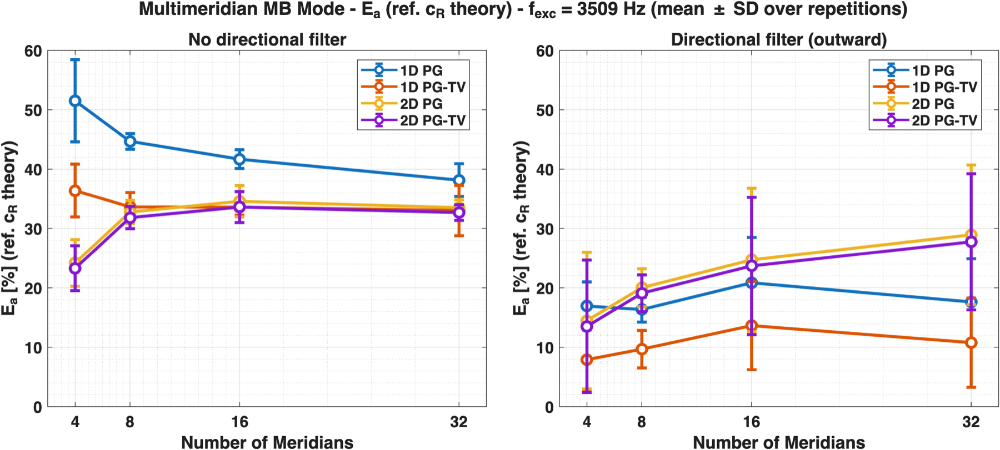
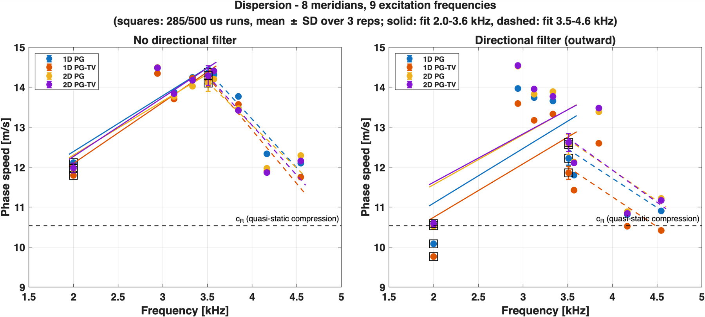
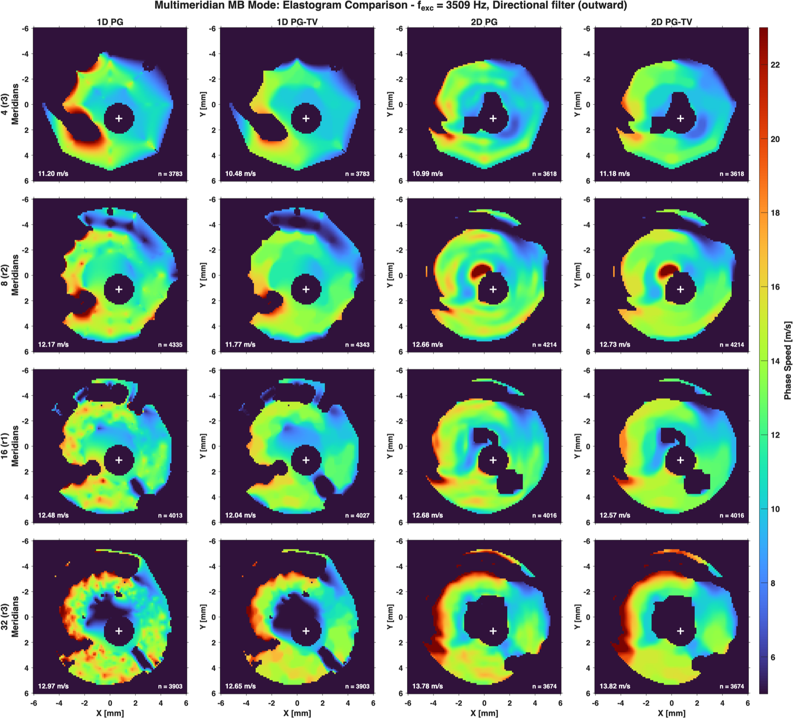
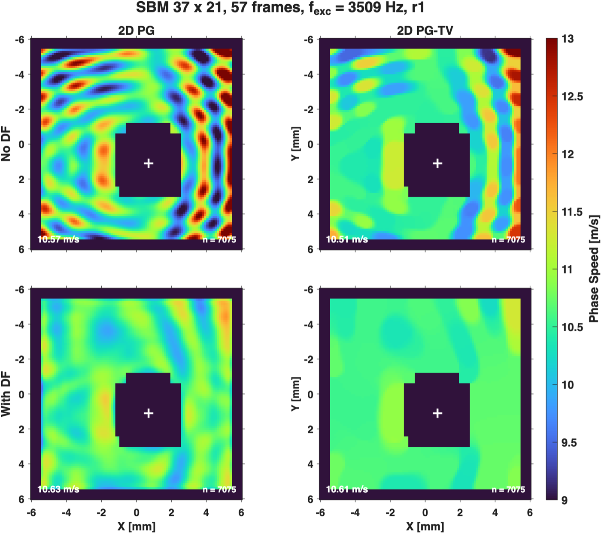

# OCE_Experimental_Protocols

Experimental implementation of the Multimeridian MB and Synchronized BM-mode (SBM) acquisition protocols for wave-based OCE, on both **swept-source (SS-OCT)** and **spectral-domain (SD-OCT)** systems.

Acquisition and processing code used to implement and validate, on real swept-source and spectral-domain OCT systems, the wave-based Optical Coherence Elastography (OCE) acquisition protocols developed in the undergraduate thesis of **Estéfano Machado Ferrer** (supervisor: Prof. Fernando Zvietcovich, PhD; Biophotonics and Biomedical Optics Research Group, GIBIO, Pontificia Universidad Católica del Perú):

- **Synchronized BM-mode (SBM)**, a novel protocol introduced in the thesis and not yet published in a peer-reviewed journal: raster BM scan locked to a harmonic excitation, repeated over frames so that each pixel is sampled in equivalent time; per-pixel acquisition-phase compensation and 2D phase-gradient speed estimation.
- **Multimeridian MB mode**: M-B scans along several meridians around the excitation source.

The protocols are implemented on two kinds of OCT system:

- **Swept-source OCT:** GIBIO's 1300 nm **Twin OCT** (200 kHz A-line rate, AlazarTech ATS9360 digitizer, NI-DAQ analog outputs, LabVIEW).
- **Spectral-domain OCT:** a 1310 nm SD-OCT system (50 kHz A-line rate), using the same generator and processing chain, with the camera line trigger as the master clock and an SD-OCT A-line reconstruction (see [Using the code on a spectral-domain OCT](#using-the-code-on-a-spectral-domain-oct)).

The generator and the processing are system-agnostic. Only the raw-spectrum-to-complex-A-line step (`SBM_FrameCplx`), the raw-file header reader and the acquisition-software glue are system-specific; the `SBM_TwinOCT_*` prefix is historical. The simulation framework is in the companion repository **[OCE_AcquisitionProtocols_Simulator](https://github.com/emftech/OCE_AcquisitionProtocols_Simulator)**, which also has the thesis manuscript.

## Repository layout

```
OCE_Experimental_Protocols/
├── SBM_Protocol/                      SBM acquisition: hardware-pattern generator and LabVIEW integration
│   ├── SBM_TwinOCT_Config.m           every protocol parameter (edit this)
│   ├── SBM_TwinOCT_Waveform.m         galvo X/Y, B-trigger and excitation AO rows + exact timeline
│   ├── SBM_TwinOCT_LabVIEWNode.m      called from the LabVIEW script node; saves the sidecar
│   ├── Variant_A_ExternalGenerator/   excitation by an external function generator
│   ├── Variant_B_DAQ_Sine/            excitation synthesized by the NI DAQ
│   ├── Tools/                         validation, null checks, smoke tests, quick processing
│   └── Validation/                    figures from the validation tools
├── Codes_SBM_Processing/              SBM processing: raw .bin → recovered wavefield → 2D PG / PG-TV elastograms
│   ├── Main_Processing_SingleExp_SBM_EMF.m, Main_Processing_Batch_SBM_EMF.m
│   ├── SBM_Pipeline/                  SBM functions
│   └── Tests/                         synthetic dataset + end-to-end test
├── Main_Processing_SingleExp_MultimerMB_EMF.m (+ _Live.mlx)   Multimeridian MB processing, one acquisition
├── Main_Processing_Batch_MultimerMB_EMF.m                     all MB acquisitions + summary
├── Make_*_MMB.m                       MB figures and depth videos
├── Check_ExperimentalChain_On_Simulations_MB.m   runs the experimental MB chain on simulated data
├── Codes/                             shared processing functions
│   ├── MultimerMB_Pipeline/           MB functions (MMB_*)
│   ├── PhaseGradient_Framework/       1D/2D phase-gradient and TV-regularized estimators (OCE_*)
│   └── *.m                            GIBIO lab OCE helpers (surface detection, Loupas estimator, ...)
├── Experiment_Log_06_10_2026.xlsx     MB run list
├── Experiment_Log_SBM_19_10_2026.xlsx SBM run list
├── Experimental_Setup_Images/
├── figures/                           representative results (see below)
├── Data/, Results/                    MB raw data / outputs (not tracked)
└── SBM_Experiments/{Data,Sidecars,Results}   SBM raw data, sidecars, outputs (not tracked)
```

Detailed documentation: [`SBM_Protocol/README.md`](SBM_Protocol/README.md) and [`Codes_SBM_Processing/README.md`](Codes_SBM_Processing/README.md).

## Requirements

- MATLAB R2026a (developed and tested).
- Signal Processing, Image Processing, Statistics and Machine Learning, and Curve Fitting toolboxes.
- For running the acquisition: the OCT system's acquisition software (not included). On the swept-source Twin OCT this is LabVIEW with the GIBIO acquisition VIs and the MATLAB script node.
- `Check_ExperimentalChain_On_Simulations_MB.m` and the MB batch's comparison with simulations expect the simulator repository cloned **next to** this one (`../OCE_AcquisitionProtocols_Simulator`).

All paths are relative to the repository root, so nothing has to be edited to run the scripts. The `.m` scripts find the root by themselves. For the live script `Main_Processing_SingleExp_MultimerMB_EMF_Live.mlx`, set MATLAB's current folder to the repository root first.

## Quick start

1. **Check the SBM protocol without hardware:** run `SBM_Protocol/Tools/SBM_TwinOCT_PlotVectors.m` and `SBM_Protocol/Tools/SBM_TwinOCT_Validate.m` (waveform → sampling → phase recovery).
2. **Test the SBM processing end to end:** run `Codes_SBM_Processing/Tests/SBM_Test_Pipeline.m`. It builds synthetic `.bin` files with a known speed (10.54 m/s) and processes them.
3. **Process real data:** put the `.bin` files in `Data/` (MB) or `SBM_Experiments/Data/` (SBM), with names as in the experiment logs, and run the single-experiment or batch scripts.

Raw data are not included because of their size (hundreds of GB); they are available from the author on reasonable request.

## Using the code on a spectral-domain OCT

What changes between the swept-source Twin OCT and an SD-OCT system (everything not listed is unchanged):

| Item | Twin OCT (swept source) | SD-OCT: what to do |
|---|---|---|
| **Master clock** | laser sweep trigger 200 kHz → DAQ AO sample clock and digitizer | **Camera line trigger.** Either the DAQ generates the line trigger and the camera runs in external line-trigger mode, or the camera's line-out drives the DAQ AO sample clock. Galvos, B-trigger, excitation and camera lines must share **one** clock, and P must be an integer at that rate. |
| **Record per trigger** | ATS9360 in AUX trigger-enable mode: R lines per B-trigger edge | Frame grabber / camera **frame trigger** with a frame of R lines started by the B-trigger. Alternative: acquire continuously, count lines, and cut the R·C lines of each frame at `Info.TrigIdx`. Either way the processing needs `[nS × R·C × N_F]` in acquisition order. |
| **Galvo lag** | `TrigDelay` = 30 A-lines | Measure on the new system with a **null run** (`SBM_TwinOCT_NullCheck`): it reports the serpentine shift and the delay to set. Scale it with the line rate. |
| **Sampling instant** | A-line ≈ instant | Each line integrates over the **exposure** `t_exp`. That is a constant offset (global phase, harmless) plus an amplitude loss `sinc(f_exc·t_exp)`. Keep `t_exp ≪ T_exc`. Fast galvo motion during exposure blurs the speckle, so check that the beam moves less than about a spot size per line. |
| **Complex A-line** | k-clocked sweep → Hann + FFT (`SBM_FrameCplx`) | **Replace `SBM_FrameCplx`** with the SD-OCT reconstruction: background removal, λ→k resampling, dispersion compensation, FFT. It must return complex depth profiles `[nZ × R·C]` for one frame. **Everything after it is unchanged.** |
| **Raw file / header** | LabVIEW `.bin` (text header + uint16) | Either write the same header (key list in `SBM_ReadBinHeader.m`) or adapt `SBM_ReadBinHeader` / the `memmapfile` call in section 2 of the single-experiment script. |
| **Excitation** | DAQ sine on ao3 (`"sine"`), or Rigol 1-cycle burst re-triggered every P lines | Same options. The DAQ sine has P steps per period (fine when P ≳ 10). A generator must be **re-triggered every P lines** from the line clock (a counter dividing the line trigger by P). Never free-run it. |
| **AO channel count** | LabVIEW had to use the **4-channel** AO task; with 3 channels the excitation row was silently dropped | Check on a scope that the excitation channel really outputs during the scan. |
| **Phase sign / velocity** | `λ0 = 1.3 µm`, `n = 1.39` (`Cfg.OCT.*` in the script) | Set the centre wavelength and refractive index of the new system. |

## Representative results

The MB experiments below were run on a tissue-mimicking phantom (reference Rayleigh speed c_R = 10.54 m/s from quasi-static compression) with needle excitation on the swept-source Twin OCT.

### Multimeridian MB mode: experimental

| | |
|---|---|
|  |  |
| En-face particle-velocity wavefield (8 meridians, 3509 Hz), without and with the outward directional filter | Depth-resolved wavefield along one meridian, overlaid on the B-mode |
|  |  |
| Accuracy error vs. number of meridians for the four estimators (mean ± SD over repetitions) | Phase-speed dispersion over 9 excitation frequencies |



Phase-speed maps for 4, 8, 16 and 32 meridians (rows) with 1D PG, 1D PG-TV, 2D PG and 2D PG-TV (columns), 3509 Hz, directional filter on.

### SBM: protocol validation and end-to-end test on synthetic data

| | |
|---|---|
|  |  |
| One SBM frame as sent to the hardware: galvo X/Y, B-trigger and excitation, all on the A-line clock | Ideal phase, raw sampled phase, exact acquisition phase from the timeline, and recovered phase after compensation |



Full SBM processing chain on synthetic `.bin` files (37 x 21 raster, 57 frames, 3509 Hz, true c = 10.54 m/s): 2D PG and 2D PG-TV, without and with the directional filter.

## Credits

- Protocols, acquisition generator, SBM and MB pipelines and phase-gradient framework: Estéfano Machado Ferrer (parts written with Claude Code).
- The helper functions directly in `Codes/` (e.g. `FindSurface`, `Loupas2D_Fast`, `Elastogram`, `MotionAnalysisBorder`, `PhaseDerivativeSpeed`) come from the GIBIO OCE processing codes developed in Prof. Fernando Zvietcovich's group; `nanmedfilt2` is adapted from a MATLAB Central thread.

## Citation

Please cite the thesis (and the corresponding journal articles once published):

```bibtex
@thesis{MachadoFerrer2026SBM,
  author = {Machado Ferrer, Estéfano},
  title  = {Development of an Acquisition Protocol for Non-Cylindrical Wave Propagation in Wave-Based OCE},
  school = {Pontificia Universidad Católica del Perú},
  year   = {2026},
  type   = {Undergraduate thesis}
}
```

## License

MIT (see [LICENSE](LICENSE)).
